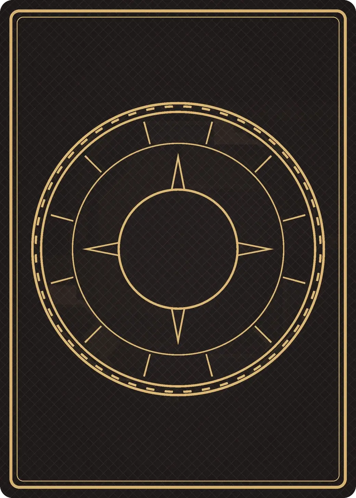
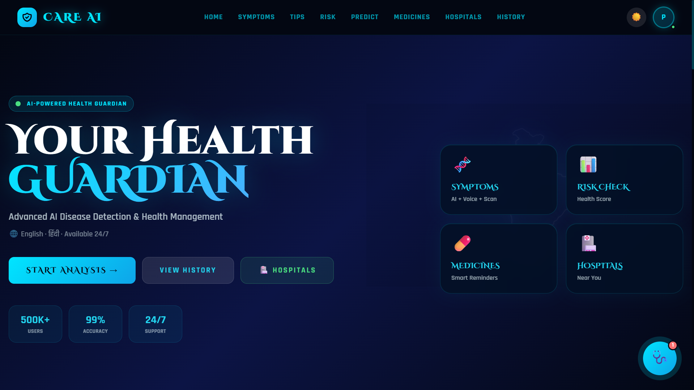
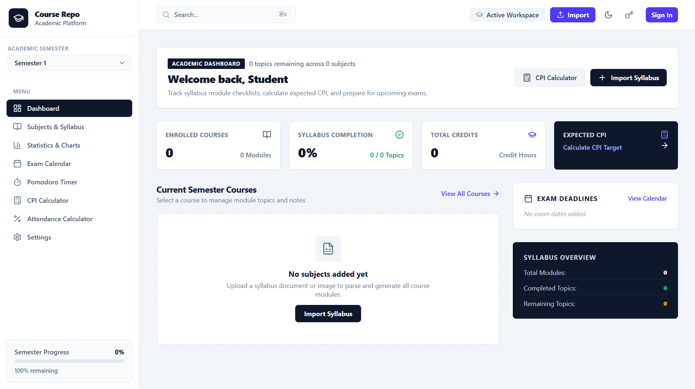
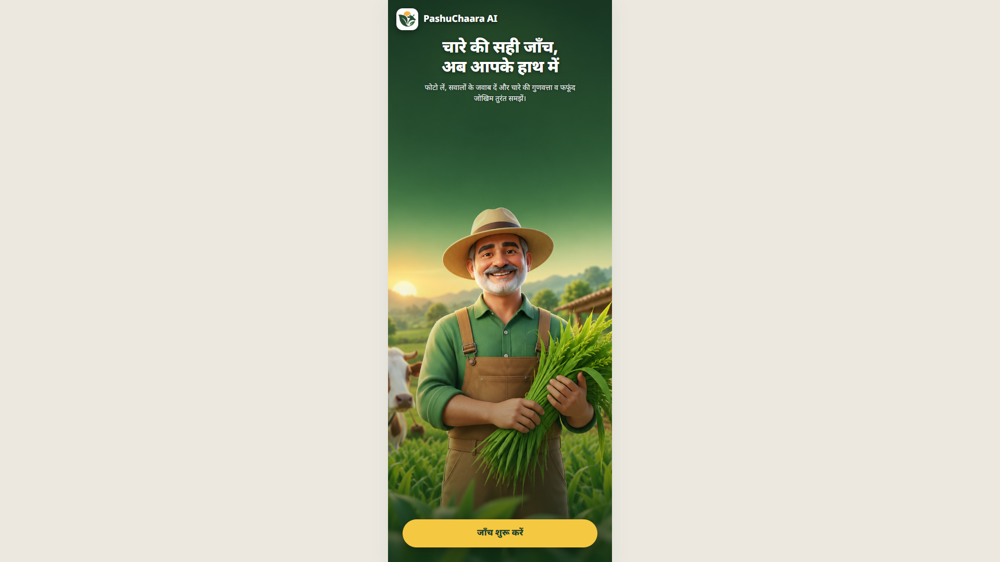
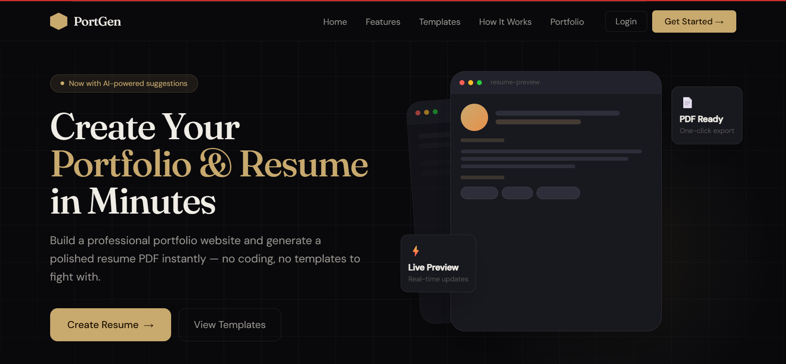
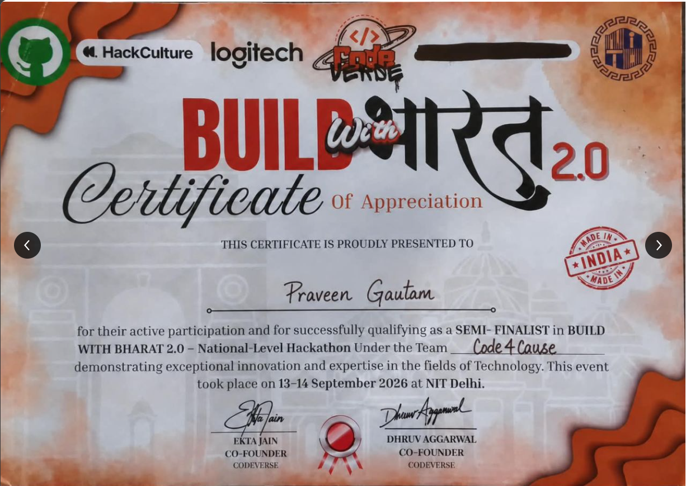
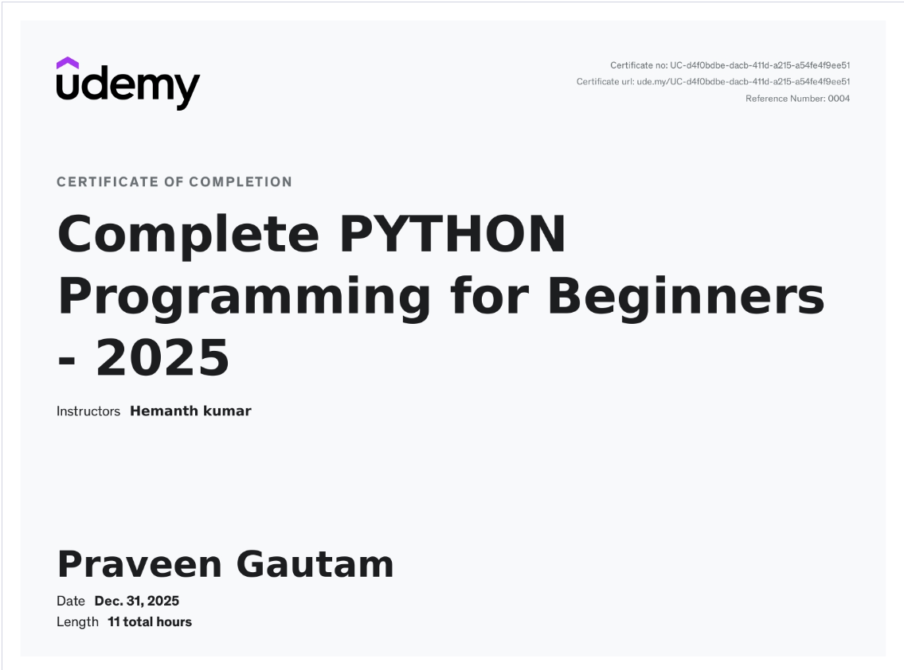
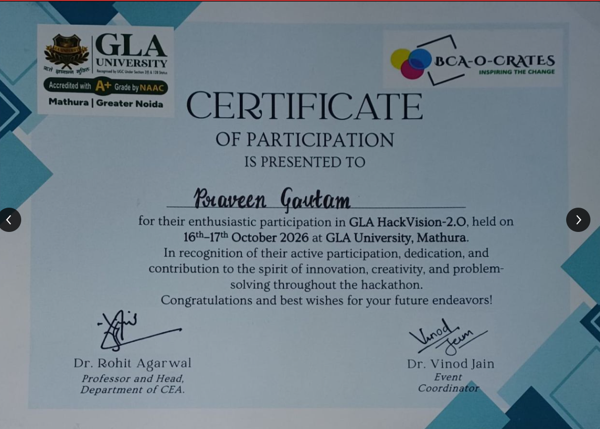
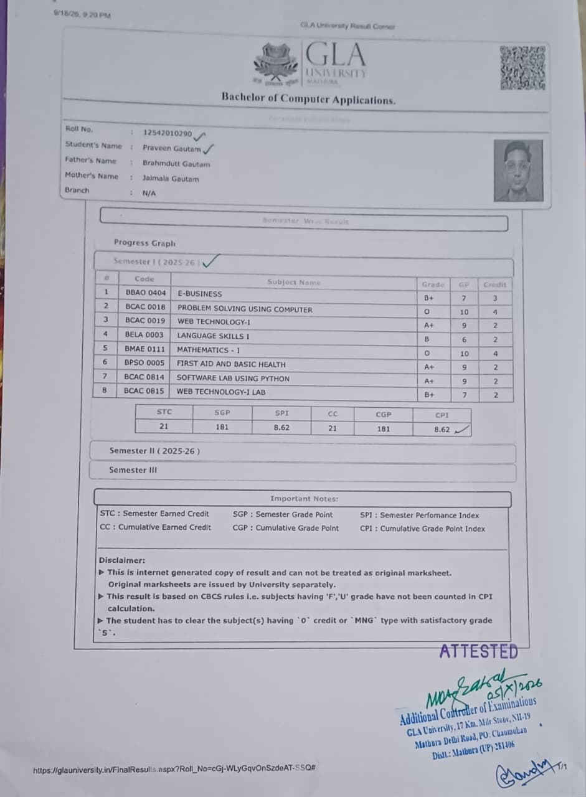

<div align="center">

  

  # ⚡ Praveen Gautam — Living Developer Portfolio

  **Next-Generation Interactive Personal Portfolio, 3D Discipline Showcase & Executive ATS Resume**

  [](https://portfolio-murex-one-95.vercel.app/)
  [](https://github.com/Praveenpandit315)
  [](https://www.linkedin.com/in/praveen-gautam-1a065830b/)
  [](mailto:PraveenGautam433603@gmail.com)

  <br />

  [](#-technology-stack)
  [](#-technology-stack)
  [](#-technology-stack)
  [](#-technology-stack)
  [](#-technology-stack)
  [](#-technology-stack)

</div>

---

## 📑 Table of Contents

- [Project Overview](#-project-overview)
- [Live Preview & Visual Tour](#-live-preview--visual-tour)
- [Key Features](#-key-features)
- [Interactive Showcase & Domains](#-interactive-showcase--domains)
- [Featured Projects](#-featured-projects)
- [Verified Credentials & Certificate Gallery](#-verified-credentials--certificate-gallery)
- [Executive ATS Resume](#-executive-ats-resume)
- [Unified "Let's Connect" Modal](#-unified-lets-connect-modal)
- [Technology Stack](#-technology-stack)
- [Project Architecture & Directory Structure](#-project-architecture--directory-structure)
- [Local Setup & Development Guide](#-local-setup--development-guide)
- [Deployment Guide](#-deployment-guide)
- [Customization Guide](#-customization-guide)
- [Future Roadmap](#-future-roadmap)
- [License](#-license)
- [Author & Connect](#-author--connect)
- [Acknowledgements](#-acknowledgements)

---

## 🌟 Project Overview

**Praveen Gautam’s Living Portfolio** is an engineered developer portfolio crafted to replace boilerplate portfolio websites with a performant digital experience. Built using vanilla modern web standards (**HTML5**, **CSS3**, **ES6+ JavaScript**, and **Lenis smooth scrolling**), it delivers a dark aesthetic inspired by modern engineering tools and creative agency portfolios.

### 🎯 Primary Purpose
- **Engineered Showcase**: Highlight full-stack and mobile applications built for national hackathons (NIT Delhi Build with Bharat 2.0, SynerrgiX, SDGI Global University, GLA University HackVision 2.0).
- **Interactive Multi-Disciplinary Experience**: Separate distinct technical disciplines—**Web Development**, **App Development**, and **UI/UX Design**—through 3D interactive portals.
- **Credential Authenticity**: Showcase 18 verified academic and industry credentials via an interactive clothesline gallery and Lightbox zoom.
- **Frictionless Recruiter Conversion**: Provide a one-click executive ATS-friendly resume (`/resume/`) with real-time plain-text clipboard extraction and instant PDF export.

---

## 🖥️ Live Preview & Visual Tour

| **Desktop Hero & Interactive Doors** | **Responsive Experience** |
| :---: | :---: |
|  |  |

- 🌐 **Production Website**: [https://portfolio-murex-one-95.vercel.app/](https://portfolio-murex-one-95.vercel.app/)
- 📄 **ATS Resume Direct Route**: [https://portfolio-murex-one-95.vercel.app/resume/](https://portfolio-murex-one-95.vercel.app/resume/)
- 🏅 **Certificates Gallery**: [https://portfolio-murex-one-95.vercel.app/Certificates/](https://portfolio-murex-one-95.vercel.app/Certificates/)

---

## ⚡ Key Features

### 1. 🚪 3D Discipline Portals (`data-door`)
Interactive perspective doors allowing visitors to drill down into specialized discipline showcases:
- **Web Developer Portal** (`/web-developer/`): Deep dive into full-stack web applications, technical problem-solution breakdowns, and live deployments.
- **App Developer Portal** (`/app-developer/`): Cross-platform mobile solutions built with Capacitor, React, and Android integration.
- **UI/UX Designer Portal** (`/ui-ux-designer/`): High-fidelity design systems, SVG mockups, user flow architectures, and design case studies.

### 2. 🎴 4-Card Ability Deck (`#holo`)
A structured 4-pillar capability panorama:
1. **Connect Directly**: Instant access to communication channels.
2. **Tech Stack**: Frontend, Backend, Database, and Tooling proficiency.
3. **Developer Tools**: Modern dev environments, Git, Figma, and productivity workflows.
4. **Experience & Journey**: Startup frontend engineering leadership and academic achievements.

### 3. 🎡 Interactive Story Wheel (`#story`)
A milestone timeline showcasing key growth chapters from initial programming foundations to leading EdTech frontend architecture and winning national hackathon distinctions.

### 4. 👔 Executive ATS-Friendly Resume (`/resume/`)
A printable, screen-reader-accessible, and ATS-optimized resume:
- **🖨️ One-Click Print to PDF**: Custom `@media print` style sheet configured for clean single-page Letter/A4 export without browser clutter.
- **📋 Copy Plain Text for ATS**: Single-click clipboard copying formatted with standard ASCII headers for instant pasting into enterprise ATS portals (Workday, Greenhouse, Lever).
- **🤝 Integrated Connect Modal**: Direct connection options without leaving the resume sheet.

### 5. 📬 Unified 3-Section "Let's Connect" Modal
A dark glassmorphic modal triggered globally from navigation, footer, and resume:
- **Email Directly** (Highlighted warm accent): Triggers client-side `mailto:PraveenGautam433603@gmail.com` with zero friction.
- **Connect on LinkedIn**: Direct verified link to Praveen's professional network.
- **GitHub Profile**: Instant redirect to public open-source repositories.
- **Keyboard & Touch Accessible**: Full `Esc` key handling, backdrop click dismiss, and focus restoration.

### 6. 🎨 Performance & Typography
- **Inlined Lenis Smooth Scroll**: Inertial wheel and touch scrolling (`vendor/lenis.min.mjs`).
- **Self-Hosted Onest Typography**: Locally hosted WOFF2 variable fonts (`fonts/onest-latin.woff2`, `fonts/onest-latin-ext.woff2`) eliminating external Google Fonts network latency.
- **Fluid Viewport Clamping**: Responsive typography and cards tuned for mobile screens up to 4K displays.

---

## 💼 Featured Projects

### 1. Care AI — Healthcare Guidance & Emergency Clinic Triage
<div align="center">
  
</div>

- **Distinction**: SynerrgiX Buildstation Hackathon Distinction
- **Problem**: Acute patient panic and unclear symptoms frequently delay urgent medical care or flood emergency departments unnecessarily.
- **Solution**: An accessible clinical triage application evaluating symptoms into 3 actionable urgency tiers (Mild, Moderate, Urgent), voice-assisted input, and automated browser geolocation routing to the nearest 24/7 emergency clinic.
- **Tech Stack**: `React.js`, `JavaScript (ES6+)`, `Tailwind CSS`, `Node.js`, `Geolocation Web API`
- **Key Assets**: `web-developer/web_care_Ai.png`, `app-developer/app_careai.png`, `app-developer/icon_careai.png`

---

### 2. Course Repo AI — Centralized Academic Knowledge Repository
<div align="center">
  
</div>

- **Platform**: GLA University Student Academic Community Portal
- **Problem**: Crucial university study resources, semester lecture notes, and previous year question papers (PYQs) get scattered across transient chat groups, causing revision friction.
- **Solution**: A search-indexed web portal consolidating semester-wise lecture notes, syllabus trackers, and PYQ databases with instant client-side keyword filtering and offline local caching.
- **Tech Stack**: `React.js`, `JavaScript (ES6+)`, `Tailwind CSS`, `HTML5`, `CSS3`, `LocalStorage API`
- **Key Assets**: `web-developer/web_courserepoai.png`

---

### 3. Pashuchara AI — Livestock Ration Balancer & Fodder Marketplace
<div align="center">
  
</div>

- **Distinction**: National Finalist — NIT Delhi *Build with Bharat 2.0*
- **Problem**: Seasonal green fodder shortages and unorganized middleman pricing trigger cattle malnutrition and severe financial distress for rural dairy farmers.
- **Solution**: A cross-platform mobile and web application calculating exact daily dry-matter nutritional requirements based on cattle body weight and milk yield, paired with a 1-tap WhatsApp and phone directory connecting farmers with verified regional fodder suppliers.
- **Tech Stack**: `React.js`, `Capacitor`, `JavaScript`, `Tailwind CSS`, `Node.js`, `Cross-Platform Mobile`
- **Key Assets**: `web-developer/web_pashucaraai.png`, `app-developer/app_pashuchara.png`, `app-developer/icon_pashuchara.png`

---

### 4. PortGenZ — Interactive Developer Portfolio & Resume Generator
<div align="center">
  
</div>

- **Status**: Live Production Utility Tool
- **Problem**: Early-career developers spend dozens of hours wrestling with boilerplate CSS instead of highlighting their code, creating severe friction in job applications.
- **Solution**: An interactive web utility generating modern developer portfolios with live split-screen preview, customizable themes, JSON schema export, and 1-click production-ready static code packaging.
- **Tech Stack**: `React.js`, `JavaScript (ES6+)`, `Tailwind CSS`, `HTML5 Canvas`, `Vercel CI/CD`
- **Key Assets**: `web-developer/web_portgenz.png`, `app-developer/app_portgenz.jpeg`, `app-developer/icon_portgenzrt.png`

---

### 5. Additional Hackathon & Domain Solutions
- **ExamOpt AI** (`web-developer/web_examopt.png`): Smart exam revision and question paper analyzer — *GLA University HackVision 2.0 Distinction*.
- **AgriSync AI** (`ui-ux-designer/mock-ux-agrisync.svg`): Agritech crop health advisory system — *SDGI Global University (SGU) Hackathon Finalist & Innovation Distinction*.
- **KhetSheTu** (`web-developer/app_khetshetu.jpg`, `app-developer/app_khetshetu.jpg`): Direct farmer-to-market agricultural commerce application.

---

## 🏅 Verified Credentials & Certificate Gallery

The portfolio features a dedicated, responsive clothesline credential gallery at `/Certificates/` categorized into 4 galleries:

<div align="center">

| **National Hackathons** | **Technical Certifications** | **Hackathon Distinctions** | **Seminars & Academics** |
| :---: | :---: | :---: | :---: |
|  |  |  |  |
| **NIT Delhi**<br />Build with Bharat 2.0 | **Python Programming**<br />Language Credential | **GLA University**<br />HackVision 2.0 Distinction | **GLA University**<br />8.6 CGPA Academic Record |

</div>

### Complete Verified Accreditations (18 Files in Repository)
1. **NIT Delhi**: Build with Bharat 2.0 National Finalist (`Certificates/nit_delhi_hacthon.png`)
2. **SDGI Global University**: SGU Hackathon Finalist & Innovation Distinction (`Certificates/sdgi_hackathon.jpeg`)
3. **GLA University**: HackVision 2.0 Hackathon Distinction (`Certificates/hackvision2.0.png`)
4. **SynerrgiX**: Buildstation Hackathon Project Distinction (`Certificates/Synergix hackathon.png`)
5. **DevCrust Hackathon**: Project Distinction & Recognition (`Certificates/devcrust hackathon.png`)
6. **Serve Smart Hackathon**: Official Participation & Honors (`Certificates/serve smart hackathon.png`)
7. **Talentine Hackathon**: Technical Project Honors (`Certificates/talentine hackathon.png`)
8. **Vibe with India Hackathon**: National Hackathon Distinction (`Certificates/vibe with india hacakathon.png`)
9. **BAOIAM EdTech Startup**: Frontend Lead Internship Experience Letter (`Certificates/Experience letter.png`)
10. **TCS Credential**: Professional Technical Assessment (`Certificates/tcs.png`)
11. **Python Programming**: Verified Core Language Credential (`Certificates/Python.png`)
12. **Microsoft Office Specialist**: Professional Productivity Suite Mastery (`Certificates/Ms_office.png` & `Certificates/ms.png`)
13. **Web-Quest Frontend Challenge**: Technical Coding Distinction (`Certificates/web-quest.png`)
14. **Technical Coding Competition**: Problem-Solving Honors (`Certificates/tech competion.png`)
15. **Visionary Tech Talk**: Technical Engineering Seminar (`Certificates/visnory tech talk.png`)
16. **Technical Workshop**: Engineering Hands-On Participation (`Certificates/wrkshop_partcipation.jpg`)
17. **Gita Youth Festival**: Distinction & Participation Award (`Certificates/gita_fest_partcipated.jpg`)
18. **GLA University Official Transcripts**: First-Year 8.6 CGPA Honors (`Certificates/1st_sem.jpg`, `Certificates/2nd_sem.jpg`)

---

## 🛠️ Technology Stack

```
┌────────────────────────────────────────────────────────────────────────┐
│                          CLIENT APPLICATION                            │
│  HTML5 Semantic Web • Modern CSS3 Design Tokens • Vanilla ES6+ JS      │
├───────────────────────────────────┬────────────────────────────────────┤
│         INTERACTION LAYER         │          TYPOGRAPHY & ASSETS       │
│  • Lenis Smooth Scroll Engine     │  • Self-Hosted Onest (WOFF2)       │
│  • 3D CSS Perspective Transforms  │  • Inline Scalable Vector Graphics │
│  • Focus-Trap Modal Controls      │  • WebP High-Efficiency Visuals    │
├───────────────────────────────────┴────────────────────────────────────┤
│                       PRODUCTION DEPLOYMENT                            │
│  • Vercel Edge Global CDN • Static Zero-Config Asset Serving          │
└────────────────────────────────────────────────────────────────────────┘
```

| Domain | Technology / Library | Usage in Codebase |
| :--- | :--- | :--- |
| **Markup** | HTML5 Semantic Standard | Structured landmark elements (`main`, `nav`, `section`, `dialog`) across all subpages |
| **Styles** | CSS3 Custom Properties | Unified dark palette (`#151313`, `#E27B38`, `#1A1818`), responsive flexbox & grid |
| **Typography** | Onest Font Family | Self-hosted via `@font-face` in `fonts/onest-latin.woff2` and `onest-latin-ext.woff2` |
| **Scripting** | Vanilla JavaScript (ES6+) | Hardware-accelerated modal layers, interactive doors, clothesline physics, dynamic year/clock |
| **Smooth Scroll** | Lenis v1.3.23 (`vendor/lenis.min.mjs`) | Inertial touch & mousewheel scroll harmonization |
| **Packaging** | NPM & Node.js | Local script runner, package configuration, and asset pipeline |
| **Hosting** | Vercel CI/CD | Automatic continuous deployment from GitHub branch `main` |

---

## 📁 Project Architecture & Directory Structure

```
praveen-portfolio/
├── .gitignore                   # Excludes node_modules, dist, logs, and temp files
├── README.md                    # Comprehensive repository documentation
├── package.json                 # Dependency definitions and dev scripts
├── styles.css                   # Core portfolio styling and typography tokens
├── app.js                       # Primary JavaScript interactions & animations
├── index.html                   # Main portfolio landing page & 3D portals
│
├── resume/                      # Executive ATS-Friendly Resume Subsystem
│   └── index.html               # Printable ATS resume, copy text script, and connect modal
│
├── Certificates/                # Authentic Credentials Showcase
│   ├── index.html               # 4-gallery clothesline with responsive Lightbox
│   ├── 1st_sem.jpg              # GLA University Semester 1 transcript (8.6 SGPA)
│   ├── 2nd_sem.jpg              # GLA University Semester 2 transcript (8.6 SGPA)
│   ├── Experience letter.png    # BAOIAM Frontend Lead internship letter
│   ├── nit_delhi_hacthon.png    # NIT Delhi Build with Bharat 2.0 certificate
│   ├── hackvision2.0.png        # GLA University HackVision 2.0 certificate
│   ├── Synergix hackathon.png   # SynerrgiX Buildstation Care AI certificate
│   ├── sdgi_hackathon.jpeg      # SDGI Global University Hackathon distinction
│   ├── Python.png               # Python programming certification
│   ├── Ms_office.png            # Microsoft Office Specialist certification
│   └── ... (18 authentic certificates & distinctions)
│
├── web-developer/               # Web Development Domain Showcase
│   ├── index.html               # Specialized Web Engineering project gallery
│   ├── web_care_Ai.png          # Care AI high-resolution interface preview
│   ├── web_courserepoai.png     # Course Repo AI repository interface preview
│   ├── web_pashucaraai.png      # Pashuchara AI livestock portal preview
│   ├── web_portgenz.png         # PortGenZ portfolio builder preview
│   └── web_examopt.png          # ExamOpt AI exam preparation preview
│
├── app-developer/               # App Development Domain Showcase
│   ├── index.html               # Specialized Mobile Engineering project gallery
│   ├── app_careai.png           # Care AI mobile interface preview
│   ├── app_pashuchara.png       # Pashuchara AI cross-platform mobile preview
│   ├── app_portgenz.jpeg        # PortGenZ mobile device preview
│   ├── app_khetshetu.jpg        # KhetSheTu agricultural commerce preview
│   └── icon_*.png               # High-resolution mobile application launcher icons
│
├── ui-ux-designer/              # UI/UX Design Domain Showcase
│   ├── index.html               # Specialized UI/UX design case studies
│   ├── mock-ux-agrisync.svg     # AgriSync vector wireframe mockup
│   ├── mock-ux-examopt.svg      # ExamOpt vector wireframe mockup
│   ├── mock-ux-portgenz.svg     # PortGenZ vector wireframe mockup
│   └── uiux.png                 # Multi-screen UI/UX design overview
│
├── card/                        # 3D Ability Cards Visuals
│   ├── Screenshot 2026-11-07 172727.png # Desktop hero capture
│   ├── back.webp                # 3D card back texture
│   └── win_bg.webp              # Windows glass backdrop texture
│
├── fonts/                       # Self-Hosted Web Fonts
│   ├── onest-latin.woff2        # Primary variable Latin font
│   └── onest-latin-ext.woff2    # Extended Latin glyphs
│
├── vendor/                      # Third-Party Vendor Libraries
│   └── lenis.min.mjs            # Standalone Lenis smooth-scrolling library
│
└── assets / root icons/         # Favicon & Progressive Web App metadata
    ├── favicon.ico              # Browser tab favicon
    ├── icon-192.png             # Standard PWA icon
    ├── icon-512.png             # High-res PWA icon
    ├── apple-touch-icon.png     # iOS home screen bookmark icon
    ├── newprof.png              # High-res profile avatar
    └── prof.png                 # Alternative profile visual
```

---

## 💻 Local Setup & Development Guide

Follow these steps to run the portfolio on your local machine:

### Prerequisites
- Any modern web browser (Google Chrome, Mozilla Firefox, Microsoft Edge, Safari)
- Optional: [Node.js](https://nodejs.org/) (v16.0 or higher) for local server execution

### 1. Clone the Repository
```bash
git clone https://github.com/Praveenpandit315/living_portfolio.git
cd living_portfolio
```

### 2. Launch Local Server

#### Option A: Using Node / NPX (Recommended)
You can instantly serve the static repository without installing dependencies:
```bash
npx serve .
# Or using http-server
npx http-server -p 3000
```

#### Option B: Using Python
If you have Python installed:
```bash
# Python 3.x
python -m http.server 3000
```

#### Option C: Using VS Code Live Server
1. Open the cloned folder in VS Code.
2. Install the **Live Server** extension (`ritwickdey.LiveServer`).
3. Right-click `index.html` and click **"Open with Live Server"**.

Visit `http://localhost:3000` in your browser to experience the live portfolio!

---

## 🚀 Deployment Guide

This repository contains static assets with zero external runtime dependencies, making it deployable on any modern hosting provider in seconds:

### Deploy to Vercel (Current Production)
1. Fork or push this repository to your GitHub account.
2. Go to [Vercel Dashboard](https://vercel.com/) and click **"Add New Project"**.
3. Import `living_portfolio`.
4. Keep the default settings (**Framework Preset: Other** and Root Directory: `./`).
5. Click **"Deploy"**. Vercel will output your live URL.

### Deploy to Netlify
1. Log in to [Netlify](https://www.netlify.com/).
2. Select **"Add new site"** > **"Import an existing project"**.
3. Select your GitHub repository.
4. Leave build command empty and set publish directory to `.` (root).
5. Click **"Deploy Site"**.

### Deploy to GitHub Pages
1. Navigate to your repository settings on GitHub: `Settings` > `Pages`.
2. Under **Build and deployment** > **Source**, choose **Deploy from a branch**.
3. Select branch `main` and folder `/ (root)`.
4. Click **Save**. Your site will be published at `https://<username>.github.io/<repo-name>/`.

---

## 🎨 Customization Guide

If you are adapting this portfolio for your personal showcase, modify these files:

### 1. Personal Information & Bio
- Open `index.html` and update:
  - Header name, roles, and status.
  - Profile image (`newprof.png`).
  - Contact links in the footer and `#modal`.

### 2. ATS Resume
- Open `resume/index.html`:
  - Update `<h1>PRAVEEN GAUTAM</h1>` and contact items.
  - Modify the `plainTextResume` template string inside the `<script>` tag to keep the **"Copy Plain Text for ATS"** button in sync with your changes.

### 3. Project Showcase
- Replace the project cards in `web-developer/index.html` and `app-developer/index.html`.
- Add your project previews into `web-developer/` and `app-developer/` folders.

### 4. Certificates Gallery
- Place new certificate images into `Certificates/`.
- Open `Certificates/index.html` and add corresponding image tags to the clothesline pin containers.

### 5. Theme Colors
- Open `styles.css` and adjust the CSS custom properties in `:root`:
  ```css
  :root {
    --panel: #151313;          /* Main dark background */
    --accent: #E27B38;         /* Warm amber accent */
    --foreground: #f5f5f5;     /* Primary text color */
  }
  ```

---

## 🗺️ Future Roadmap

- [ ] **PWA Offline Service Worker**: Enable full offline caching of certificates and project previews.
- [ ] **Interactive Project Demos**: In-page interactive sandboxes or live iframe embeds for featured tools.
- [ ] **Automated GitHub Activity Feed**: Dynamic commit and repository metrics powered by GitHub REST API.
- [ ] **Dark / Light Contrast Switcher**: Toggleable high-contrast accessibility theme mode.

---

## 📄 License

This portfolio codebase and presentation are designed, authored, and maintained by **[Praveen Gautam](https://github.com/Praveenpandit315)**.

All personal information, custom media assets, certificates, project mockups, and personal branding are **Proprietary & All Rights Reserved**.  
The underlying HTML/CSS/JavaScript layout architecture may be referenced as an educational resource for personal non-commercial developer portfolio building.

---

## 👨‍💻 Author & Connect

<div align="center">

### **Praveen Gautam**
*Frontend Developer & Software Engineer*  
*GLA University, Mathura — Bachelor of Computer Applications (BCA) · 8.6 First-Year CGPA Distinction*

[](https://www.linkedin.com/in/praveen-gautam-1a065830b/)
[](https://github.com/Praveenpandit315)
[](mailto:PraveenGautam433603@gmail.com)
[](https://portfolio-murex-one-95.vercel.app/)

</div>

---

## 🙏 Acknowledgements

- **[Lenis Smooth Scroll](https://github.com/darkroomengineering/lenis)** by Darkroom Engineering for smooth inertial scroll dynamics.
- **[Onest Typeface](https://fonts.google.com/specimen/Onest)** for modern monospace-feel heading aesthetics.
- **GLA University**, **NIT Delhi**, **SDGI Global University**, and **SynerrgiX** for hosting national hackathons and developer opportunities.
- **BAOIAM EdTech** for professional startup frontend leadership experience.

---

<div align="center">
  <sub>Crafted with passion, modern web standards, and precision by Praveen Gautam.</sub>
</div>
